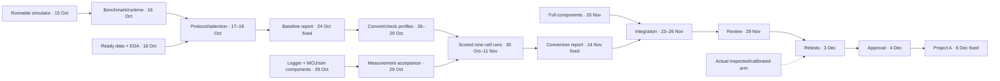

# SO101 resolved planning decisions and revised schedule

**Latest working schedule — amended 25 October 2026:** [Decision 0006](../../technical/decisions/0006-model-roster-baseline-and-profile-allocation.md) replaces ACT/Diffusion Policy with Pi0/X-VLA and records the revised baselines/ownership. [Decision 0007](../../technical/decisions/0007-epic-timeline-and-handoff-refinement.md) and the [applied epic/child timeline](../jira/SO101_Epic_Timeline_Refinement_2026-10-25.md) now govern current working dates: benchmark/protocol 31 October, baseline/path acceptance 1 November, comparison 1–19 November (profile execution through 16 November; freeze 17th; report 18th; review 19th), components 20 November, integrated acceptance 26 November, closure/reproduction 3 December, approval 4 December and final submission 6 December. The course package remains due 15 November with interim comparison findings. Dates in the original version 3 narrative below are historical where superseded; no official university extension is asserted.

**Version 3 — 12 October 2026, Asia/Bangkok. Updated from the user's answers.**

**Plan:** keep the fixed EDA report on **16 October**, baseline report on **24 October**, conversion report on **14 November**, and Project A final submission on **6 December**. The working three-model recommendation is **SmolVLA, ACT and Diffusion Policy**, with **OpenVLA as the fourth candidate**. All three selected models still require FP16, INT8 and INT4 results on the actual VENTUNO Q, with simulation results for all nine combinations. Disclosed mixed precision is permitted.

The proposed task windows now distinguish conversion preparation from scored measurements: convert frozen checkpoints from **26 October**, deliver the measurement components on **28 October**, accept the complete path on **29 October**, and begin scored runs on **30 October**. Full components finish **20 November**, full integration runs **23–26 November**, review is **29 November**, retesting closes **3 December**, and evidence approval is **4 December** before the **6 December** submission.

This version resolves the report-date, candidate-list, training-resource, precision-definition and individual-report ambiguities raised in version 2. Implementation, compatibility tests and supplier deliveries remain future work with defined gates. It does not certify completed experiments or supported combinations. Dates outside the fixed deadlines remain proposals. No Jira changes or messages were made; both original files and version 2 are preserved.

## Approved amendment — 21 October 2026

The current Project A scope is simulation, nine VENTUNO Q profiles, reports and minimum web experiment console. Printed-arm production and its isolated approval, BOM/order, receipt, assembly, physical calibration and positioning tasks are removed. The 30 November printed-arm checkpoint is superseded. GPU/board access, simulator, communication, command/fault checks and core integration remain required.

Chung is the sole Project A IoT member and owner of all retained IoT tasks. The active team is Hoan, Duc, Khanh, Trieu and Chung. Review Chung's task load and handoff conflicts without inventing capacity. Commercial-arm Project B work remains conditional and its future owner is confirmed at rebaseline. Existing report/course dates and retained issue sprint memberships are preserved.

### Acknowledgment

The team acknowledges Nguyen for contributions during the earlier project phase. Nguyen is no longer an active member or task owner in the current plan. Historical contribution records remain intact.

The 12 October captures below are historical where superseded; the integrated master plan, decision 0004 and the 21 October Jira snapshot define current ownership and scope.

## 1. Decisions recorded from the user

| Item | Settled information | Consequence |
|---|---|---|
| EDA report | **16 Oct 2026** | Supersedes the stale 13 Oct description target for planning; report and parent 11 share 16 Oct. |
| Baseline report | **24 Oct 2026** | Keep fixed; use readiness gates and a result freeze on 22 Oct. |
| Conversion report | **14 Nov 2026** | Keep fixed; evidence freeze 11 Nov, full draft 12 Nov, technical review 13 Nov. |
| Course submissions | Project plan **25 Oct**, Sprint 1 **15 Nov**, Project A final **6 Dec 2026** | Separate course packages from the AI reports; reserve compilation and preflight time. |
| Individual research reports | Due **11 Oct 2026**, **already completed by all six members** | Remove all future individual-report draft tasks proposed in version 2. This is user-confirmed completion, not a Jira status change. |
| Project B | Deadline **unknown**; Semester 2 starts **11 Jan 2027** | Maintain a provisional Jan–May roadmap and a dated deadline-confirmation action. Project A's deadline is settled. |
| Dataset/splits | Ready; `lerobot/svla_so100_pickplace` | Audit existing identifiers/split manifest and mapping; do not plan another selection exercise. |
| Models | SmolVLA chosen; candidates also ACT, Diffusion Policy and OpenVLA | Full candidate list is known. The final three-model recommendation below remains subject to runtime/data checks. |
| Compute | RTX 5060 and **two RTX 4090s on the school server** available | Use independent school-GPU jobs for training; actual job setup and elapsed duration are still checked. |
| Board and code | VENTUNO Q available; no simulator/code yet at the latest implementation update | Installation, adapters, logger and native inference are scheduled deliverables. |
| Experiment matrix | All three selected models at **FP16/INT8/INT4 on VENTUNO Q**, with simulation for each | Nine mandatory result cells; laptop/server inference cannot replace board results. |
| Precision | **Disclosed mixed precision allowed** | Record weights, activations, exceptions, placement and actual execution rather than assert uniform INT4/INT8 math. |
| Person-hour planning | User requests task completion scheduling without hours/week modelling | This plan uses task ownership, deliverable handoffs, report protection and equipment/job ordering. No hourly estimates or assumed spare capacity are introduced. |

## 2. Working technical decisions for the proposal

### Select the three models with the shortest viable route to the fixed reports

**Working selection: SmolVLA, ACT and Diffusion Policy. Reserve: OpenVLA.** SmolVLA preserves the user's choice; ACT supplies a conventional action-chunking comparator; Diffusion Policy supplies a diffusion comparator. This is a comparison of robot policies on the bounded task, not a claim that all three are VLAs or that identical training steps make their optimization equally mature.

LeRobot documents ACT as a low-compute starting policy, and provides SmolVLA fine-tuning and a Diffusion Policy implementation. Keeping these within one dataset/tooling route reduces avoidable integration work. It does not prove any of them supports all three precision profiles on VENTUNO Q. [ACT documentation](https://huggingface.co/docs/lerobot/act), [SmolVLA documentation](https://huggingface.co/docs/lerobot/smolvla), [Diffusion Policy implementation](https://github.com/huggingface/lerobot/blob/main/src/lerobot/policies/diffusion/configuration_diffusion.py)

OpenVLA's documented standard LoRA example needs approximately 27 GB or more GPU memory, depending on batch configuration, and custom data requires integration with its dataset loader. The project would also need a validated action/camera mapping and board deployment route. This adds work before 24 October. The recommendation is to retain it as the fourth researched candidate, not require a fourth trained model. Quantized training or sharding might make it viable, but that is an additional implementation to demonstrate. [OpenVLA repository](https://github.com/openvla/openvla)

NVIDIA specifies 24 GB for RTX 4090 and 8 GB for the standard desktop RTX 5060; verify the installed 5060 variant during setup. Two 4090s permit separate jobs but do not automatically act as one 48 GB device. DDP replicates a model across devices; an explicit sharding/offload design would be needed to address per-device model memory. [RTX 4090 specifications](https://www.nvidia.com/en-us/geforce/graphics-cards/40-series/rtx-4090/), [RTX 5060 specifications](https://www.nvidia.com/en-us/geforce/graphics-cards/50-series/rtx-5060-family/), [PyTorch DDP documentation](https://docs.pytorch.org/tutorials/intermediate/ddp_tutorial.html)

**Proposed job order:** school GPU A initially runs SmolVLA and school GPU B initially runs ACT; Diffusion Policy takes the first school 4090 slot released by a completed job. Independent runs can overlap once their prerequisites pass. The 5060 supports development, data checks, simulator work and small pilots that actually fit; it is not assumed to fit a full production run. Server login, CUDA/framework compatibility, dataset access, checkpoint storage and job slots must be usable by 13 October. Record a small engineering throughput/memory probe by 16 October and a production-recipe forecast on 19 October. No A100 training-time example is used as a 4090 estimate.

If the proposed three cannot pass the required export/native-board probes, Hoan and Duc must record a model/runtime decision before final commitment on 18 October. OpenVLA is an available candidate to assess, not an automatically compatible fallback. The fixed report dates and nine-cell requirement remain in force unless the user explicitly changes them.

### Use a simulator that matches the chosen data and control interface

**Working simulator recommendation: ManiSkill's SO100 model, with a bounded pick-and-place evaluation scene mapped to the ready dataset.** Its published SO100 model has six DoF and joint-position controller options; its parameters are not fully identified. This is a suitable candidate to pilot, not proof of equivalence to the physical SO101. [ManiSkill SO100 documentation](https://maniskill.readthedocs.io/en/latest/robots/so100/)

The dataset card identifies SO100, six action/state values, top/wrist views and a published training partition. Preserve the user's prepared validation/test split manifest; the public training partition does not establish those custom splits. Pin the dataset and software revisions. [Dataset card](https://huggingface.co/datasets/lerobot/svla_so100_pickplace)

Chung owns simulator preparation and interface mapping. The deliverable on 15 October must reset/step the environment, return both agreed camera views and state, apply a valid action, and log observations. The benchmark pilot on 16 October must demonstrate a meaningful success/failure signal and a simple reference controller, then test the policy/data mapping. Joint order, units, normalized values, gripper convention, camera identifiers/geometry and timestamps are explicit acceptance checks. Dimensions alone are insufficient.

The project reports **simulation performance in the defined scene**, actual board inference/resources and conditional physical results separately. Real-to-simulation visual/dynamics differences are recorded as limitations. LIBERO is not automatically substituted: a different embodiment/action space would need new data/mapping/protocol evidence and an explicit scope decision.

### Define the comparison before running it

Freeze the following by 17 October, and include them in SO101-35:

- Primary outcome: task success rate, with an explicit success rule, timeout and denominator. Secondary outcomes: task duration, board inference latency, observed peak memory, package size and failures.
- Same frozen dataset, episode/session splits, observation cameras/state, task instructions where applicable, simulator scene, initial-state list and success definitions across the three models.
- Model-specific training/adaptation settings and checkpoint selection use training/validation data. Do not tune on the final-test outcomes. Record compute, stopping rules and stochastic/denoising settings; equal step counts alone are not a fair-comparison guarantee.
- Preserve one unquantized reference checkpoint and its dtype for each model, then derive all three deployment profiles from that same frozen checkpoint. Keep a reference controller separate from the learned-model references.
- Proposed initial test budget: **30 matched simulator rollouts per learned reference and per deployment cell**, plus **100 matched timed board requests per cell after five warm-up requests**. These are proposed experimental counts, not completed trials or an assumed power guarantee. The 16–17 October pilot must show the budget fits; otherwise present an explicit protocol/budget decision before scored runs. Report uncertainty and do not claim precise rankings from a small sample.
- Use the same recorded initial-state/seed list across variants; log failures, exceptions, retries and timeouts. A rerun is linked to its original outcome; it does not silently erase the failure.
- Measure model execution and complete request/response separately. Record simulator time separately from wall-clock time, and board inference separately from transport/MCU/actuation. Report median and p95 inference latency with the request count and clock boundaries.

This budget implies **90 learned-reference simulation rollouts** and **270 deployment-cell simulation rollouts**, plus **900 timed board requests**. Warm-ups, calibration, engineering tests and any scripted-reference trials are additional. If a reference and a deployment cell are truly identical in checkpoint, runtime and protocol, evidence reuse must be documented; server FP16 results do not replace board FP16 evidence.

The study is exploratory performance research. Acceptance requires valid, reproducible coverage and honest outcomes; it does not require an invented minimum success percentage or that quantization improve every metric. A failed grasp is still an outcome; an unmeasured or unsupported deployment is an incomplete required cell.

### Define mixed precision and native board evidence precisely

The user allows INT8/INT4 quantized weights with higher-precision activations or sensitive/unsupported layers. For each model, declare the eligible quantized modules and use a consistent coverage policy when comparing its INT8 and INT4 profiles. Record exceptions and retained higher-precision fractions; select calibration/exception rules using permitted training/validation data, never final-test results.

| Profile | Required declaration and evidence |
|---|---|
| FP16 | Exact weight/operator dtype, preprocessing, runtime/backend and fallback placement; demonstrate the actual board profile. |
| INT8 mixed | Quantized weight/module coverage, activation dtype, calibration method/data, sensitive-layer exceptions, dequantization and backend placement. |
| INT4 mixed | Same disclosure, including packing/loading and actual dequantization or kernels. Do not equate compressed file size with peak runtime memory. |

Arduino documents the Linux/Qualcomm processor and STM32H5F5 MCU linked through RPC. Use the Linux processor side for the inference investigation and the MCU for the agreed action/feedback path; the exact model/runtime split is tested under 34/36. [VENTUNO Q documentation](https://docs.arduino.cc/hardware/ventuno-q)

Qualcomm documents quantization profiles such as W4A8 and W4A16, which illustrates why a four-bit label needs weight/activation detail. Documentation of a toolkit option is not proof that this policy or board combination exports and runs. [Qualcomm AI Hub API documentation](https://workbench.aihub.qualcomm.com/docs/hub/api.html)

Use the same runtime/compute unit within each model's three-way comparison where demonstrated feasible. If backend placement differs, report a **deployment-profile comparison** and avoid attributing all changes solely to bit width. NPU acceleration is an investigation, not a new mandatory deliverable. CPU/GPU/NPU placement on VENTUNO Q must be reported for each profile; no laptop or school-server measurement substitutes for it.

The nine results must come from actual converted/loaded policy profiles on VENTUNO Q. Engineering fake-quantization or unpacked floating-point emulation is labelled as such and cannot be presented as native INT4 execution. Disclosed mixed precision does not waive native-board evidence, the complete policy's action behavior, or nine-cell coverage.

## 3. Jira evidence and date authority

The read-only refresh at **15:20 Asia/Bangkok, 12 October 2026** returned the final page of all **45 SO101 issues** and all three native sprints from **board 2**. Complete issue records and sprint records are identical to the earlier version 2 capture, which matched the original snapshot. Counts remain 4 epics, 38 tasks, 3 report subtasks, 25 saved issue links (11 Blocks/14 Relates), and 41 parent relationships. SO101-41 is absent. All statuses remain To Do; user-confirmed course completion and new planning facts have not been written to Jira.

The Jira defects remain in the saved record: SO101-30 has reversed dates; several tasks lack dates; epic Due fields are empty; 42 is overdue; 34 is assigned to Hoan despite stale Duc text; 24 has stale empty-IoT-assignee wording; EDA descriptions still say 13 Oct. The current proposal supplies concrete corrections without applying them.

| Classification | Dates/information |
|---|---|
| User-confirmed deadlines/completion | Individual research due 11 Oct and completed; EDA 16 Oct; baseline 24 Oct; plan 25 Oct; conversion 14 Nov; Sprint 1 submission 15 Nov; Project A final 6 Dec. |
| Current Jira fields | Appendix A and saved-link audit; they are the live record at capture, including errors. |
| Recorded project milestones | Review meetings 8/29 Nov; evidence reconciliation from 30 Nov; intentional sprint overlap. |
| Proposed task/milestone dates | All other intervals below, including component delivery, acceptance, integration, retesting and Semester 2 reserves. |
| Technical facts established by sources | Named hardware specifications and documented software interfaces; no model/board compatibility is inferred from them. |
| Unverified external state | Supplier shipment/receipt, actual native profile execution and training elapsed duration; Project B final date. |

| Native sprint / board 2 | State | Stored start (UTC+7) | Stored end (UTC+7) |
|---|---|---|---|
| SO101 Sprint 1 (id 2) | future | 2026-10-10 14:50:09 | — |
| SO101 Sprint 2 (id 3) | future | — | — |
| SO101 Pre-Sprint (id 4) | future | 2026-09-13 00:00:00 | 2026-10-24 00:00:00 |

**Proposed phase scheduling:** retain current issue membership; use Pre-Sprint for 13 Sep–24 Oct, Sprint 1 for 10 Oct–15 Nov, and an overlapping Sprint 2 planning envelope for **12 Oct–6 Dec**, covering its currently allocated early feasibility tasks. These phase windows organize work; task prerequisites determine actual starts. Native sprint states remain future and are not actual progress records. Pre-Sprint's stored 24 Oct 00:00 end excludes that day's working time; adoption must choose the intended cutoff. Course/LMS cutoff times control submissions and remain to be verified; they are not assumed to be midnight. For internal deliverables, propose handoff by 17:00 Bangkok on the due day, with acceptance on the following scheduled day.

## 4. Proposed dates for every current issue

Every interval below is proposed except a due date explicitly confirmed above. Starts on/after 12 October are remaining-work windows. Historical epic starts are project anchors, not claims of work performed. Current Jira fields appear separately in Appendix A.

| Issue / work | Current owner | Proposed start | Proposed due | Reason, condition and permitted overlap |
|---|---|---|---|---|
| [SO101-1](https://huu-hoan-hoang.atlassian.net/browse/SO101-1) — Project management | Hoan | 2026-09-13 | 2026-12-06 | Semester 1 management envelope; project continues in the separate Semester 2 proposal. |
| [SO101-2](https://huu-hoan-hoang.atlassian.net/browse/SO101-2) — Experiment console | Khanh | 2026-09-13 | 2026-12-04 | Console delivery plus integration corrections; avoid closing the workstream at first demo. |
| [SO101-3](https://huu-hoan-hoang.atlassian.net/browse/SO101-3) — AI research and deployment | Duc | 2026-09-13 | 2026-12-04 | AI reports plus reproduction and integration support through Semester 1 closure. |
| [SO101-4](https://huu-hoan-hoang.atlassian.net/browse/SO101-4) — IoT and simulation | Chung | 2026-09-13 | 2026-12-04 | Simulator and conditional arm work plus retesting; an unavailable arm is deferred, not completed. |
| [SO101-5](https://huu-hoan-hoang.atlassian.net/browse/SO101-5) — UX/UI and sketch | Trieu | 2026-10-16 | 2026-10-23 | After console scope on 15 Oct. Freeze sketch on Friday to allow frontend from 26 Oct. |
| [SO101-6](https://huu-hoan-hoang.atlassian.net/browse/SO101-6) — Frontend build | Trieu | 2026-10-26 | 2026-11-06 | First mock-based slice 30 Oct; tested agreed frontend 6 Nov. Extends current 30 Oct completion; live acceptance is separate. |
| [SO101-7](https://huu-hoan-hoang.atlassian.net/browse/SO101-7) — Architecture/protocol | Khanh | 2026-10-12 | 2026-10-20 | Architecture draft 15 Oct; controller decision 15 Oct; incorporate contract 19 Oct before final design 20 Oct. |
| [SO101-8](https://huu-hoan-hoang.atlassian.net/browse/SO101-8) — Backend build | Khanh | 2026-10-21 | 2026-11-20 | Minimal runner/logger 28 Oct; complete scoped backend 20 Nov; component QA included. Integration 23–26 Nov. |
| [SO101-9](https://huu-hoan-hoang.atlassian.net/browse/SO101-9) — AWS clarification | Khanh | 2026-10-12 | 2026-10-15 | Resume/verify supervisor guidance. Hosting requirements unresolved; local measurement route needs explicit scope agreement. |
| [SO101-10](https://huu-hoan-hoang.atlassian.net/browse/SO101-10) — Requirements | Trieu | 2026-10-12 | 2026-10-13 | Bounded requirements draft feeding scope, console and course plan. |
| [SO101-11](https://huu-hoan-hoang.atlassian.net/browse/SO101-11) — EDA and strategy | Hoan | 2026-10-14 | 2026-10-16 | Use audited ready dataset/splits after 31; EDA/report only. Simulator-dependent training recipe stays gated by 32/35/33. |
| [SO101-12](https://huu-hoan-hoang.atlassian.net/browse/SO101-12) — Three-model baseline | Duc | 2026-10-19 | 2026-10-24 | Fixed 24 Oct report: proposed SmolVLA/ACT/Diffusion Policy; three reference checkpoints/results frozen 22 Oct; technical review 23 Oct. Full production comparisons require 16–18 Oct gates. |
| [SO101-16](https://huu-hoan-hoang.atlassian.net/browse/SO101-16) — Sprint 1 review | Hoan | 2026-11-05 | 2026-11-08 | Team evidence 5–6 Nov; review meeting 8 Nov, as recorded. Conversion work remains interim; course package due 15 Nov. |
| [SO101-17](https://huu-hoan-hoang.atlassian.net/browse/SO101-17) — Sprint 2 review | Hoan | 2026-11-27 | 2026-11-29 | Review pack 27 Nov follows integrated acceptance 26 Nov; meeting 29 Nov; evidence follow-up from 30 Nov. |
| [SO101-18](https://huu-hoan-hoang.atlassian.net/browse/SO101-18) — Nine-cell conversion experiment | Duc | 2026-10-26 | 2026-11-14 | Fixed 14 Nov report. Convert/calibrate frozen references 26–29 Oct while harness is built; scored nine-cell measurements only after 29 Oct path acceptance, from 30 Oct; evidence freeze 11 Nov. |
| [SO101-19](https://huu-hoan-hoang.atlassian.net/browse/SO101-19) — MCU/simulator output | Chung | 2026-10-26 | 2026-11-20 | Early MCU/simulator path 28 Oct after samples 23 Oct; deterministic replay, faults and full evidence through 20 Nov. |
| [SO101-20](https://huu-hoan-hoang.atlassian.net/browse/SO101-20) — Communication sample tests | Chung | 2026-10-20 | 2026-10-23 | Both communication legs after runnable simulator, controller path and 19 Oct contract. Earlier completion allows weekday handoff to 19. |
| [SO101-21](https://huu-hoan-hoang.atlassian.net/browse/SO101-21) — Simulator selection/readiness | Chung | 2026-10-12 | 2026-10-15 | Candidate decision 14 Oct; separate reproducible simulator readiness gate 15 Oct. No simulator exists as of user update. |
| [SO101-22](https://huu-hoan-hoang.atlassian.net/browse/SO101-22) — Benchmark and baseline | Hoan | 2026-10-12 | 2026-10-16 | Research in parallel; final benchmark/reference recommendation only after runnable simulator pilot and dataset/embodiment check. |
| [SO101-23](https://huu-hoan-hoang.atlassian.net/browse/SO101-23) — Scope and acceptance | Hoan | 2026-10-12 | 2026-10-14 | Approve bounded research scope, platform-specific claims and minimum console; use requirements and early rubric scan. |
| [SO101-24](https://huu-hoan-hoang.atlassian.net/browse/SO101-24) — Task ownership/access and authority | Hoan | 2026-10-12 | 2026-10-13 | Confirm task owners, reviewers, school GPU access/job ownership and fallback authority. No hours-per-week model requested or required for this proposal. |
| [SO101-25](https://huu-hoan-hoang.atlassian.net/browse/SO101-25) — Compute/board access | Hoan | 2026-10-12 | 2026-11-02 | Retained access/setup gate and board/GPU reservations; printing approval is removed from Project A. |
| [SO101-26](https://huu-hoan-hoang.atlassian.net/browse/SO101-26) — Course/phase decisions | Hoan | 2026-10-12 | 2026-10-20 | Report/course dates now settled; propose phase cutoffs and handoff rules, including staged conversion/integration. Preserve Jira phase membership until adoption. |
| [SO101-27](https://huu-hoan-hoang.atlassian.net/browse/SO101-27) — Collaboration/repository rules | Hoan | 2026-10-12 | 2026-10-19 | Repository/evidence minimum rules 13 Oct; broader collaboration and document rules 19 Oct. Avoid pretending all governance closes today. |
| [SO101-28](https://huu-hoan-hoang.atlassian.net/browse/SO101-28) — Risk ownership | Hoan | 2026-10-12 | 2026-10-20 | Early technical risk triggers 13 Oct; complete register 20 Oct for project plan. Weekly refresh is continuing PM work. |
| [SO101-29](https://huu-hoan-hoang.atlassian.net/browse/SO101-29) — Course rubric/authorship | Hoan | 2026-10-12 | 2026-10-14 | Record 11 Oct individual reports as user-confirmed completed, Project A deadline 6 Dec; finish Alpha/package checklist and track unknown Project B deadline. |
| [SO101-30](https://huu-hoan-hoang.atlassian.net/browse/SO101-30) — Final evidence approval | Hoan | 2026-11-30 | 2026-12-04 | Draft from review/physical status; final approval only on 4 Dec after integration closure 3 Dec. Corrects reversed current dates. |
| [SO101-31](https://huu-hoan-hoang.atlassian.net/browse/SO101-31) — Dataset/split decision record | Hoan | 2026-10-12 | 2026-10-13 | Audit ready svla_so100_pickplace dataset and existing splits: revisions, episode manifest, units/cameras, provenance and leakage checks. No reselection. |
| [SO101-32](https://huu-hoan-hoang.atlassian.net/browse/SO101-32) — Learning/adaptation strategy | Duc | 2026-10-14 | 2026-10-16 | Use LeRobot SmolVLA adaptation and ACT/Diffusion training recipes on the same frozen data; select configurations/checkpoint rules through validation before scored comparison. |
| [SO101-33](https://huu-hoan-hoang.atlassian.net/browse/SO101-33) — Four candidates/final three | Duc | 2026-10-12 | 2026-10-18 | Four candidates confirmed: SmolVLA, ACT, Diffusion Policy, OpenVLA. Working recommendation keeps first three, reserves OpenVLA; final compatibility evidence and protocol approval precede training. |
| [SO101-34](https://huu-hoan-hoang.atlassian.net/browse/SO101-34) — Runtime/precision feasibility | Hoan | 2026-10-12 | 2026-10-16 | Hoan owns decision; Duc prepares nine-profile export/load/precision evidence on actual VENTUNO Q. Disclosed mixed INT8/INT4 allowed; school 4090s train, board measures; no support inferred. |
| [SO101-35](https://huu-hoan-hoang.atlassian.net/browse/SO101-35) — Evaluation protocol | Hoan | 2026-10-14 | 2026-10-17 | Freeze task success, matched episodes/initial states, repeats, timing/resource definitions and mixed-precision disclosure before model comparisons. Proposed trial budget must pass pilot check. |
| [SO101-36](https://huu-hoan-hoang.atlassian.net/browse/SO101-36) — MCU/USB execution path | Chung | 2026-10-12 | 2026-10-15 | Controller/USB reference path, observation replay option and responsibilities feed architecture/contract; verify actual board identifier. |
| [SO101-37](https://huu-hoan-hoang.atlassian.net/browse/SO101-37) — Action/state contract | Hoan | 2026-10-16 | 2026-10-19 | Freeze versioned action/state/fault contract after architecture draft/controller decision; decision uses model/data compatibility evidence. |
| [SO101-38](https://huu-hoan-hoang.atlassian.net/browse/SO101-38) — Calibration/fault procedures | Chung | 2026-10-20 | 2026-11-13 | Procedure/schema gate 22 Oct; bench/sim checks during harness hardening; physical results later under 15, not claimed here. |
| [SO101-39](https://huu-hoan-hoang.atlassian.net/browse/SO101-39) — Simulator/sample ordering | Chung | 2026-10-12 | 2026-10-13 | Resolve initial simulator-before-samples sequence. Research may overlap; selection/ready gates must precede scored runs. |
| [SO101-40](https://huu-hoan-hoang.atlassian.net/browse/SO101-40) — Simulator test deliverables | Chung | 2026-10-16 | 2026-10-19 | Recover truncated deliverable and freeze inputs, outputs, acceptance evidence before MCU/simulator implementation. |
| [SO101-42](https://huu-hoan-hoang.atlassian.net/browse/SO101-42) — Console workflow/scope | Khanh | 2026-10-12 | 2026-10-15 | Reforecast overdue scope approval; minimum workflow and result schema first. No implementation exists yet per user. |
| [SO101-43](https://huu-hoan-hoang.atlassian.net/browse/SO101-43) — EDA report | Hoan | 2026-10-14 | 2026-10-16 | Fixed 16 Oct EDA report within 11. Findings/configuration evidence 15 Oct, review and deliver 16 Oct; supersedes stale 13 Oct description target. |
| [SO101-44](https://huu-hoan-hoang.atlassian.net/browse/SO101-44) — Baseline report | Hoan | 2026-10-19 | 2026-10-24 | Fixed 24 Oct baseline report: methods draft early, frozen results 22 Oct, Duc technical review 23 Oct. Each lead supplies evidence; Hoan writes/consolidates. |
| [SO101-45](https://huu-hoan-hoang.atlassian.net/browse/SO101-45) — Conversion report | Hoan | 2026-11-04 | 2026-11-14 | Fixed 14 Nov conversion report: draft methods and rolling matrix 4 Nov; evidence freeze 11 Nov; complete draft 12 Nov, technical review 13 Nov. |
| [SO101-46](https://huu-hoan-hoang.atlassian.net/browse/SO101-46) — Integration and retesting | Hoan | 2026-10-20 | 2026-12-03 | Coordinate contract-based work from 20 Oct; components ready 28 Oct, measurement acceptance 29 Oct; full integration 23–26 Nov; review 29 Nov; fixes/reproduction through 3 Dec. |

Epic finishes cover Project A and its retesting support. Project B requires its own work packages or an explicit extension of those epics. Unavailable physical work is deferred with evidence; it is not marked complete to close an epic.

## 5. Milestones and report handoffs

G identifiers are proposed splits/milestones, not created Jira issues. They expose the intermediate artifacts required before later activities can proceed. Technical evidence preparation is proposed team work; current issue owners are preserved.

| ID | Work/owner | Proposed start | Proposed due | Acceptance and downstream handoff |
|---|---|---|---|---|
| G01 | Dataset manifest/access; Hoan, Duc | 2026-10-12 | 2026-10-13 | Existing split IDs, data/schema revisions, school GPU access and checkpoint storage usable. |
| G02 | Simulator selection; Chung | 2026-10-12 | 2026-10-14 | ManiSkill SO100 working recommendation assessed against the ready data/control path. |
| G03 | Runnable simulator; Chung | 2026-10-15 | 2026-10-15 | Reset/step, agreed cameras/state, valid actions and saved run instructions. |
| G04 | Benchmark pilot/reference; Hoan, Chung, Duc | 2026-10-16 | 2026-10-16 | Success/failure signal and scripted reference; camera/action mapping and bounded task work. |
| G05 | Runtime/profile feasibility; Hoan owns, Duc prepares | 2026-10-12 | 2026-10-16 | Native board probes for proposed model/profile paths, exact dtype/placement and fidelity checks; memory/throughput probes on school GPUs. No final trained-result claims. |
| G06 | Protocol and model gates; Hoan, Duc | 2026-10-17 | 2026-10-18 | Protocol frozen 17 Oct; final three confirmed 18 Oct after runtime/benchmark evidence. Weekend dates are proposed work dates, not historical work. |
| G07 | Baseline production and evidence freeze; Duc | 2026-10-19 | 2026-10-22 | Proposed GPU job order; all three frozen checkpoints, raw results, configuration and failed-run records. |
| G08 | Baseline review/report; Hoan, Duc | 2026-10-23 | 2026-10-24 | Technical review 23 Oct; fixed report 24 Oct. Methods draft can begin 19 Oct. |
| G09 | Interface/design handoff; Khanh, Chung, Hoan | 2026-10-15 | 2026-10-20 | Architecture draft/controller decision 15 Oct, contract 19 Oct, final design 20 Oct. |
| G10 | Command/fault procedure; Chung | 2026-10-20 | 2026-10-22 | Validation, stale-state, timeout/stop/fault schema before sample acceptance; actual physical results remain later. |
| G11 | Minimal runner/logger and MCU/simulator path; Khanh, Chung | 2026-10-21 | 2026-10-28 | Logger under 8 starts 21 Oct; MCU/simulator implementation under 19 starts 26 Oct after samples 23 Oct. Component artifacts available by 28 Oct. |
| G12 | Complete measurement-path acceptance; Hoan, leads | 2026-10-29 | 2026-10-29 | One traceable reference run through board, agreed MCU route, simulator and result export; verify clocks/units/version IDs and rerun. |
| G13 | Nine trained-profile export/calibration; Duc | 2026-10-26 | 2026-10-29 | Uses frozen learned references after baseline; engineering conversion may overlap G11/G12. All nine paths are probed and tracked. |
| G14 | First matrix pass; Duc | 2026-10-30 | 2026-11-04 | Each profile runs/scored or has an evidenced blocker; this is coverage status, not completion of repeated trials. |
| G15 | Main matched measurements; Duc, IoT support | 2026-10-30 | 2026-11-06 | Simulation rollouts plus actual board requests; one shared board has one booked benchmark workload at a time. |
| G16 | Reruns/evidence freeze; Duc | 2026-11-09 | 2026-11-11 | Missing/failed-run investigation, required reruns, consolidated raw evidence and limitations. |
| G17 | Conversion draft/review/report; Hoan, Duc | 2026-11-12 | 2026-11-14 | Complete draft 12 Nov, technical review 13 Nov, fixed report 14 Nov. Methods/rolling coverage draft from 4 Nov. |
| G21 | Complete components; Khanh, Trieu, Chung | 2026-11-16 | 2026-11-20 | Full scoped backend and simulator test artifacts; frontend already delivered 6 Nov. |
| G22 | Full integration; Hoan, all leads | 2026-11-23 | 2026-11-26 | UI/backend/simulator checks 23–24 Nov while conditional calibration uses the board; exclusive native board/MCU/core integration 25–26 Nov. Physical branch only after its gates. |
| G23 | Review package/meeting; Hoan, leads | 2026-11-27 | 2026-11-29 | Package follows integrated acceptance; meeting 29 Nov. Evidence and defect follow-up begins 30 Nov. |
| G24 | Corrections/reproduction; Hoan, leads | 2026-11-30 | 2026-12-03 | Lead-owned fixes, regression, independently reproduced evidence and defect disposition. |
| G25 | Package approval/preflight; Hoan, leads | 2026-12-04 | 2026-12-05 | Final approval 4 Dec follows retests; upload/preflight reserve 5 Dec; Project A submission 6 Dec. |

**Mandatory splits on adoption:** 8 early logger/full backend; 19 early native measurement path/full robustness evidence; 25 compute access; 38 board/simulator procedure and bench evidence; 46 early acceptance/full integration/retests; 30 checklist preparation/final approval. Connect dependencies to the specific intermediate output rather than block an entire long task.

## 6. Dependency and impact map

FS means the whole predecessor completes before the successor starts. Gates allow investigation or drafting to overlap but require the named artifact before the named activity/sign-off. Parent/subtask relationships must not become artificial cycles. All task numbers refer to SO101.

| Inputs/handoff | Dependency type | Consumer and impact of a slip |
|---|---|---|
| 10 requirements 13 Oct + early 29 rubric scan | Approval gate | 23 scope 14 Oct → 42 console 15 Oct; affects sketch, implementation and report scope. |
| 24/25 access and ownership + 31 dataset audit 13 Oct | Readiness; 31→11 FS | EDA starts 14 Oct; training job setup and existing data audit proceed without an hours/week model. |
| 39 ordering 13 Oct → 21 selection 14 Oct → runnable G03 15 Oct | Stage gates | 22 benchmark 16 Oct, 20 samples and later 19. A selected name alone cannot release testing. |
| 23 scope + runnable simulator → 22/G04 benchmark 16 Oct | Acceptance gate | Protocol 35 and final model gate 33. Bad task/camera/action mapping can invalidate comparisons. |
| 11 EDA + 22 benchmark + 32 recipe + 34 runtime evidence → 35 protocol 17 Oct → 33 final three 18 Oct | Approval gates | Model commitment waits; candidate research/probes may overlap. No whole-ticket reciprocal 33/35 or 7/37 cycles. |
| 11, 22, 32, 33, 34, 35 complete | FS to 12 production work | Baseline begins 19 Oct. Earlier unscored engineering probes do not count as final trials. |
| 12 evidence 22 Oct → 44 report 24 Oct | Parent/subtask | Draft methods from 19 Oct; parent includes the reviewed report and cannot close before it. |
| 42 scope 15 Oct → 5 sketch 23 Oct → 6 frontend 26 Oct–6 Nov | FS | UI may use versioned mocks; live acceptance still requires integration. |
| 9 hosting answer + 7 architecture draft + 36 controller choice 15 Oct → 37 contract 19 Oct → 7 final design 20 Oct | Stage gates | 8 starts 21 Oct. Scope/design exploration can overlap; assessed implementation uses agreed design. |
| 21 runnable environment + 36 + 37 → 20 samples 20–23 Oct; 38 procedure 22 Oct | FS for implementation start; acceptance gate | Both communication legs and fault criteria must be demonstrated before 19 from 26 Oct. |
| 20 samples + 40 complete test definition + 21/37 | FS to 19 | Late/missing definition delays MCU/simulator work and integration; a connector alone is insufficient. |
| 12 report/reference complete 24 Oct + 34 runtime plan | FS to 18 conversion | 18 begins 26 Oct; conversion scripts/calibration may overlap logger/harness construction. |
| 8 early logger + 19 early path delivered 28 Oct → 46/G12 acceptance 29 Oct | Acceptance gate | **Scored** 18 activity starts 30 Oct; full backend/simulator hardening continues to 20 Nov. |
| 18 matrix first pass → 45 rolling draft; evidence freeze 11 Nov → final draft/review | Parent/subtask gates | 14 Nov report includes all nine outcomes/limitations. Missing measurements cannot become completed cells. |
| Mechanical assembly → calibration/stop test → positioning/performance trials | Conditional gates | Physical evidence enters 46 only if actual testing succeeds. Missing hardware uses the recorded simulation/board fallback. |
| 6 UI + 8/19 full components by 20 Nov + AI artifacts | Full acceptance gate | 46 integration 23–26 Nov → 17 review 29 Nov. Coordination from 20 Oct does not mean the complete system is ready. |
| 16 review 8 Nov + course sections + 45 reviewed report 14 Nov where required | Submission gate | 15 Nov course package; prepare other sections by 6 Nov to limit Hoan's late compilation work. |
| 17 review + evidence reconciliation from 30 Nov + 46 retests 3 Dec | Final evidence gate | 30 approval 4 Dec → preflight 5 Dec → Project A final 6 Dec. Drafting may overlap fixes; approval follows their closure. |
| 26 dates/phases + 27 evidence/review rules + 28 risk register + 29 rubric | Governance gates | All course packages, review evidence and final sign-off. Routine rules/checklists are scheduled outputs, not additional unanswered user questions. |

The map covers every current non-epic issue, including the three report subtasks. Epics aggregate deliverables and do not block one another. A simulator/runtime slip propagates to both report evidence and integration. A physical-arm slip affects physical claims under the recorded fallback; board evidence is still required.

This is a logical dependency map. No numerical critical path or utilization percentage is claimed.

### Every saved Jira link checked

These 25 links are current Jira data; stage gates above are analytical additions. Relates links do not enforce finish-to-start ordering.

| Saved link ID | Current relationship | Assessment and proposed handoff |
|---|---|---|
| 10055 | [SO101-5](https://huu-hoan-hoang.atlassian.net/browse/SO101-5) → blocks [SO101-6](https://huu-hoan-hoang.atlassian.net/browse/SO101-6) | Current same-day 24 Oct handoff; proposal sketch 23 Oct before frontend 26 Oct. |
| 10056 | [SO101-7](https://huu-hoan-hoang.atlassian.net/browse/SO101-7) → blocks [SO101-8](https://huu-hoan-hoang.atlassian.net/browse/SO101-8) | Current same-day 15 Nov handoff and too late for report; proposal design 20 Oct before backend 21 Oct, then staged logger. |
| 10057 | [SO101-12](https://huu-hoan-hoang.atlassian.net/browse/SO101-12) → blocks [SO101-18](https://huu-hoan-hoang.atlassian.net/browse/SO101-18) | Current order valid. Proposal 12 closes 24 Oct before conversion preparation in 18 starts 26 Oct; scored measurements wait until 30 Oct after 29 Oct acceptance. |
| 10058 | [SO101-33](https://huu-hoan-hoang.atlassian.net/browse/SO101-33) → blocks [SO101-12](https://huu-hoan-hoang.atlassian.net/browse/SO101-12) | Current same-day 15 Oct handoff. Proposal final three-model gate 18 Oct precedes 19 Oct production comparison; candidate names are now confirmed. |
| 10059 | [SO101-34](https://huu-hoan-hoang.atlassian.net/browse/SO101-34) → blocks [SO101-18](https://huu-hoan-hoang.atlassian.net/browse/SO101-18) | Current 31 Oct precedes 5 Nov but feasibility is too late for model commitment. Proposal 16 Oct precedes final model commitment and 26 Oct conversion; scored runs additionally require 29 Oct path acceptance. |
| 10060 | [SO101-42](https://huu-hoan-hoang.atlassian.net/browse/SO101-42) → blocks [SO101-6](https://huu-hoan-hoang.atlassian.net/browse/SO101-6) | Current order valid but scope is overdue/To Do; proposal scope 15 Oct before frontend 26 Oct. |
| 10061 | [SO101-37](https://huu-hoan-hoang.atlassian.net/browse/SO101-37) → blocks [SO101-46](https://huu-hoan-hoang.atlassian.net/browse/SO101-46) | Current order valid but incomplete integration prerequisites. Proposal contract 19 Oct before coordination 20 Oct; full acceptance additionally gates on components. |
| 10062 | [SO101-31](https://huu-hoan-hoang.atlassian.net/browse/SO101-31) ↔ relates to [SO101-11](https://huu-hoan-hoang.atlassian.net/browse/SO101-11) | Same pair as Blocks 10074. Informational duplicate, not another independent prerequisite. |
| 10063 | [SO101-32](https://huu-hoan-hoang.atlassian.net/browse/SO101-32) ↔ relates to [SO101-12](https://huu-hoan-hoang.atlassian.net/browse/SO101-12) | Recipe is a real comparison prerequisite despite Relates; proposal 16 Oct before 19 Oct production comparison. |
| 10064 | [SO101-35](https://huu-hoan-hoang.atlassian.net/browse/SO101-35) ↔ relates to [SO101-12](https://huu-hoan-hoang.atlassian.net/browse/SO101-12) | Current protocol finishes 2 Nov after 24 Oct report. Proposal protocol 17 Oct before 19 Oct comparisons; separate draft from approval. |
| 10065 | [SO101-36](https://huu-hoan-hoang.atlassian.net/browse/SO101-36) ↔ relates to [SO101-7](https://huu-hoan-hoang.atlassian.net/browse/SO101-7) | 36 is currently undated. Controller decision 15 Oct informs architecture draft, contract 19 Oct and final architecture 20 Oct; avoid reciprocal whole-ticket blocking. |
| 10067 | [SO101-39](https://huu-hoan-hoang.atlassian.net/browse/SO101-39) ↔ relates to [SO101-20](https://huu-hoan-hoang.atlassian.net/browse/SO101-20) | Ordering decision currently undated; proposal 13 Oct precedes samples 20–23 Oct. |
| 10068 | [SO101-39](https://huu-hoan-hoang.atlassian.net/browse/SO101-39) ↔ relates to [SO101-21](https://huu-hoan-hoang.atlassian.net/browse/SO101-21) | Proposal ordering decision 13 Oct precedes simulator choice 14 Oct/readiness 15 Oct; research can overlap. |
| 10069 | [SO101-40](https://huu-hoan-hoang.atlassian.net/browse/SO101-40) ↔ relates to [SO101-19](https://huu-hoan-hoang.atlassian.net/browse/SO101-19) | Currently no dates for missing deliverable clarification; proposal 40 finishes 19 Oct before 19 starts 26 Oct. |
| 10071 | [SO101-30](https://huu-hoan-hoang.atlassian.net/browse/SO101-30) ↔ relates to [SO101-46](https://huu-hoan-hoang.atlassian.net/browse/SO101-46) | Current 30 is reversed. Draft package overlaps retests; integration closure 3 Dec precedes final approval 4 Dec. |
| 10072 | [SO101-26](https://huu-hoan-hoang.atlassian.net/browse/SO101-26) ↔ relates to [SO101-16](https://huu-hoan-hoang.atlassian.net/browse/SO101-16) | 26 course/phase decisions by 20 Oct inform 8 Nov review. Meeting and 15 Nov submission are separate. |
| 10073 | [SO101-26](https://huu-hoan-hoang.atlassian.net/browse/SO101-26) ↔ relates to [SO101-17](https://huu-hoan-hoang.atlassian.net/browse/SO101-17) | 26 informs 29 Nov meeting, not 30 Nov hardware checkpoint. Proposal 17 ends 29 Nov. |
| 10074 | [SO101-31](https://huu-hoan-hoang.atlassian.net/browse/SO101-31) → blocks [SO101-11](https://huu-hoan-hoang.atlassian.net/browse/SO101-11) | Current same-day 12 Oct handoff; proposal audited dataset record 13 Oct before EDA 14 Oct. User now reports data/splits ready. |
| 10075 | [SO101-42](https://huu-hoan-hoang.atlassian.net/browse/SO101-42) → blocks [SO101-5](https://huu-hoan-hoang.atlassian.net/browse/SO101-5) | Current same-day 8 Oct handoff with overdue scope; proposal scope 15 Oct before sketch 16 Oct. |
| 10076 | [SO101-22](https://huu-hoan-hoang.atlassian.net/browse/SO101-22) ↔ relates to [SO101-21](https://huu-hoan-hoang.atlassian.net/browse/SO101-21) | Current benchmark due 13 Oct precedes late simulator selection. Proposal runnable simulator 15 Oct before benchmark pilot/freeze 16 Oct. |
| 10077 | [SO101-22](https://huu-hoan-hoang.atlassian.net/browse/SO101-22) → blocks [SO101-12](https://huu-hoan-hoang.atlassian.net/browse/SO101-12) | Current date order appears valid but hides missing simulator readiness. Proposal benchmark 16 Oct before comparison 19 Oct. |

### Permitted overlaps

Candidate/runtime investigation, EDA and simulator research run in parallel; scored comparisons wait for the approved configuration. Draft architecture feeds contract, which feeds final architecture. Frontend uses versioned mocks until live integration. Reports draft methods while results accumulate, then finalize after evidence freeze. Conversion preparation starts before logger completion; actual scored measurement waits for end-to-end acceptance. The printed-arm production branch is removed; retained simulation/board work continues through its own prerequisites. A changed data/model/interface/measurement revision requires affected reruns and explicit report-impact review.

## 7. Ownership and workload control through handoffs

| Person | Current items including epic | Non-epic items | Role |
|---|---|---|---|
| Hoan | 21 | 20 | AI, PM, integration, reports |
| Duc | 5 | 4 | AI lead |
| Chung | 6 | 5 | IoT lead |
| Khanh | 5 | 4 | SoftDev lead |
| Trieu | 3 | 3 | SoftDev |

Counts include epics and report subtasks; 11/43 is one EDA/report work package, and 12/44 and 18/45 divide technical execution from writing. Per the user's instruction, no hours/week model is used. The concrete control is that each output has one owner, team-prepared inputs arrive before Hoan's writing/review windows, and shared equipment jobs are ordered.

| Person | Deliverables and protection |
|---|---|
| Hoan | EDA/report 14–16 Oct; benchmark/protocol approval 16–17 Oct; contract 19 Oct; baseline/report 19–24 Oct; conversion methods 4–6 Nov and results/review 12–14 Nov; integration 23–26 Nov; retest coordination 30 Nov–3 Dec; approval 4 Dec. Technical preparation under 34 stays with Duc's proposed support while Hoan owns the decision. |
| Duc | Candidate/recipe/runtime probes 12–16 Oct; final three 18 Oct; school-GPU training/evaluation 19–22 Oct; technical review 23 Oct; conversion 26–29 Oct; nine-cell execution 30 Oct–11 Nov; report technical review 13 Nov; frozen artifact/reproduction support through 3 Dec. |
| Chung | Controller/contract input 12–19 Oct; samples 20–23 Oct; MCU/simulator path 26–28 Oct; board/communication support during measurements; fault/robustness artifact through 20 Nov; conditional calibration and integration later. Board benchmarks have exclusive booked runs rather than simultaneous competing workloads. |
| Khanh | Console scope/AWS/architecture 12–20 Oct; early runner 21–28 Oct; backend through 20 Nov; live integration 23–26 Nov. Proposed independent reproduction reviewer after implementation fixes; prepares SoftDev plan/package sections rather than leaving those to Hoan. |
| Trieu | Requirements, then sketch through 23 Oct; first UI slice 30 Oct, tested agreed scope 6 Nov; console acceptance/evidence packaging 9–20 Nov; integration/demo support 23–26 Nov. This adds explicit support work, not an assumption of spare capacity. |

Team plan sections arrive **20 Oct**; review-ready course package sections arrive **6 Nov**; full component evidence arrives **20 Nov**; final fix/reproduction evidence arrives **3 Dec**. Hoan consolidates those inputs. Khanh is the proposed backup submitter; confirm access under 27. A missing handoff triggers a scoped recovery action rather than silently moving all unfinished implementation onto Hoan.

## 8. Course submissions and completed assessments

The individual Portfolio task 1(a) reports were due **11 October** and are **user-confirmed complete for all six**. Version 2's six future CP06 draft/review windows are withdrawn. Keep submission receipts/authorship evidence in the archive; do not reopen or mark a Jira issue complete merely from this document.

CP identifiers are proposed work packages. Local course templates establish required plan sections and Alpha/Beta mapping; the user supplies the dates. Verify actual portal cutoff times during submission preparation.

| ID | Work/owner | Start | Due | Handoff |
|---|---|---|---|---|
| CP01 | Project Plan; Hoan consolidates, team supplies sections | 2026-10-14 | 2026-10-25 | Sections 20 Oct; integrated draft 21 Oct; review 22–23 Oct; preflight 24 Oct; fixed submission 25 Oct. Baseline progress/limitations are recorded rather than blocking the plan on an unpublished result. |
| CP02 | Sprint 1 course package; Hoan/team | 2026-11-02 | 2026-11-15 | Sections 6 Nov; review 8 Nov; revisions 9–10 Nov; stable shell 12 Nov; insert reviewed 14 Nov AI report where checklist requires; fixed submission 15 Nov. |
| CP03 | Physical availability/fallback record; Hoan, IoT | 2026-11-30 | 2026-11-30 | Record received/assembled/calibrated/tested states separately. If unavailable, use accepted simulation/VENTUNO Q evidence and defer physical claims. |
| CP04 | Project A Alpha checklist/report/demo/archive; Hoan/team | 2026-11-16 | 2026-12-04 | Map actual rubric to integrated evidence; prepare archive/reproduction guide during retests; final approval 4 Dec. No duplicate experiment campaign. |
| CP05 | Project A final upload/preflight/receipt; Hoan, proposed Khanh backup | 2026-12-05 | 2026-12-06 | Reserve 5 Dec for preflight/contingency; fixed final deadline 6 Dec. Submit earlier if permitted. |
| CP09 | Capture/confirm Project B calendar and Beta requirements; Hoan | 2026-10-12 | 2026-10-20 | Record authoritative deadline if published; otherwise retain explicit TBD and recheck at 11–15 Jan kickoff. This is calendar verification, not an invented submission date. |

No individual assessment deadline is left unanswered in this plan. Any additional course deliverable that the rubric actually requires is mapped under 29; no unsupplied weekly logs or new assessments are invented.

## 9. Provisional Project B schedule

Project B starts with Semester 2 on **11 January 2027**; its final deadline is **unknown**, as confirmed by the user. The following reserve windows provide an eight-month roadmap, not an approved university deadline. Eight months from 13 September reaches the 13 May anniversary; 12 May is only an illustrative last working date. Confirm the actual Project B deadline by the 15 January rebaseline and move the plan backward if needed.

No required work is booked for 7 December–10 January. Commercial-arm arrival in February is unconfirmed; the core research path continues with simulation/board evidence. A hardware branch begins from actual receipt, not a predicted delivery date.

| ID | Work/proposed lead | Start | Due | Required output/dependency |
|---|---|---|---|---|
| B01 | Rebaseline dates, scope and hardware; Hoan/all | 2027-01-11 | 2027-01-15 | Authoritative Project B calendar, Semester 1 limitations and actual inventory; decide final deliverable scope. |
| B02 | Restore/reproduce Project A environment; Chung, Khanh, Duc | 2027-01-18 | 2027-01-22 | Pinned setup and one reproduced run per valid path before changes. |
| B03 | Extension protocol/trial budget; Hoan, Duc | 2027-01-25 | 2027-01-29 | Frozen research extension and analysis plan; new models/data require fresh compatibility gates. |
| B04 | Console/simulator hardening; Khanh, Trieu, Chung | 2027-01-25 | 2027-02-05 | Stable APIs/export and reliability; measurement changes versioned and retested. |
| B05 | Extension pilot/setup freeze; Duc, Chung | 2027-02-01 | 2027-02-07 | Pilot exploration may overlap B04. Components delivered 5 Feb; acceptance 6 Feb, setup freeze 7 Feb before the 8 Feb campaign. |
| B06 | Core matched simulation/board campaign; Duc | 2027-02-08 | 2027-03-05 | Frozen setup/protocol and retained outcomes; independent of commercial-arm arrival. |
| B07 | Conditional commercial-arm receipt/calibration/pilot; owner to confirm | 2027-02-08 | 2027-02-26 | Reserve only; starts after actual receipt/inspection. Future owner is unassigned until Project B rebaseline; record the actual commercial-arm asset/calibration IDs. |
| B08 | Conditional physical campaign; IoT, Duc | 2027-03-01 | 2027-03-12 | Calibrated available arm and approved matched task/protocol; unavailable hardware triggers bounded deferral, not lost report/review buffer. |
| B09 | Reruns/robustness and evidence freeze; Duc, Chung | 2027-03-08 | 2027-03-19 | Core reruns may overlap physical testing only with non-conflicting equipment/jobs. Incorporate accepted physical evidence after 12 Mar. |
| B10 | Analysis/independent reproduction; Hoan, Duc, reviewer | 2027-03-22 | 2027-04-02 | Frozen evidence, uncertainty, limits and reproduced key results. |
| B11 | Final report; Hoan/leads | 2027-04-05 | 2027-04-16 | Leads supply sections; methods can draft earlier, conclusions follow analysis. |
| B12 | Beta/demo/handover candidate; SoftDev/IoT, Hoan | 2027-04-05 | 2027-04-16 | Integrated release, reproduction guide and actual-evidence rehearsal. |
| B13 | Review/corrections; Hoan/all | 2027-04-19 | 2027-04-30 | Reviewed claims, corrected release and course checklist. Review slot is a scheduled action, not an invitation already sent. |
| B14 | Submission/demo/closeout reserve; Hoan/all | 2027-05-03 | 2027-05-12 | Replace with actual university dates when known. **Project B deadline remains TBD.** |

## 10. Resolution record and execution gates

| Planning issue | Resolution in version 3 | What remains as execution evidence |
|---|---|---|
| Report-date conflict | 16/24 Oct and 14 Nov fixed by user | Actual report submission/receipt. |
| Individual-report placeholders | 11 Oct deadline and completed status recorded; future drafts removed | Archive existing receipts; no future report work assumed. |
| Missing model names/three-of-four choice | Four names confirmed; recommend SmolVLA/ACT/Diffusion Policy, reserve OpenVLA | Architecture/data/native-profile probes before final commitment 18 Oct. |
| Unknown training equipment | RTX 5060 + two school 4090s recorded; independent job queue proposed | Login, installed variant/framework, memory/elapsed-time probes and saved jobs. |
| Hours-per-week request | Removed from scheduling prerequisites per user direction | Owners deliver defined artifacts; collisions handled through handoffs and equipment ordering. |
| Precision ambiguity | Disclosed mixed precision allowed; coverage/dtypes/placement required | Real converted/native board profiles and action fidelity. |
| Protocol after results | Protocol 17 Oct, final model gate 18 Oct, comparisons from 19 Oct | Versioned protocol and frozen comparison conditions. |
| Selection mistaken for simulator readiness | Selection 14 Oct; runnable environment 15 Oct; benchmark pilot 16 Oct | Working scene, cameras/actions and scoring evidence. |
| Measurement too late for report | Early components 28 Oct; acceptance 29 Oct; scored runs from 30 Oct | Actual logged end-to-end rerun and nine-cell evidence. |
| Same-day conversion handoff | Conversion preparation overlaps implementation; component delivery and measurement acceptance use separate days | Consumer starts only after acceptance. |
| Order mistaken for component availability | Validation → approved release → inspected receipt → assembly | Actual complete inventory before powered work. |
| Integration ends before inputs | Components 20 Nov; integration 23–26 Nov; review 29 Nov | Integrated scenario, faults and exported evidence. |
| Approval precedes final testing | Retests 3 Dec, approval 4 Dec, preflight 5 Dec, submission 6 Dec | Reproduced required results and defect disposition. |
| Missing Project A course work | Explicit CP work packages and Alpha mapping | Course checklist and submission receipt. |
| Project B/final deadline | Explicit provisional B01–B14 plan; deadline-confirmation action | University-published deadline; no fabricated May commitment. |
| Stale/missing Jira fields and links | Concrete proposed dates, staged links and description corrections supplied | Apply only if the user later asks to modify Jira. |

Fixed deadlines do not demonstrate technical feasibility. The 24 October report remains tight: production reference evidence has 19–22 October. The conversion campaign has nine weekdays from 30 October through 11 November, of which 9–11 November are reserved for reruns. Two school GPUs help training concurrency but do not remove board/runtime/simulator dependencies.

If 16 October feasibility or the 19 October production forecast fails, notify the PM/user with the exact blocker and measured completion forecast; do not silently move a fixed report date or reduce models. If the 29 October measurement gate fails, immediately assess the impact on 14 November. If any profile remains unsupported at the 4 November coverage pass, retain its failure evidence and request a concrete model/runtime/scope decision. No unsupported cell is completed by paperwork. If components miss 13 November, reforecast physical work from actual receipt; the simulation/board route continues. If components miss 20 November, a partial demo must be described as partial and the mandatory core re-scoped explicitly. If final reproduction fails on 3 December, repair/review within the reserved buffer or raise the conflict with 6 December.

**No further user answer is needed to issue this planning revision.** Project B's unpublished date and empirical compatibility/receipt facts are tracked external/test gates. The proposed technical choices, counts and task dates remain reviewable recommendations; only the user's explicit confirmations above are treated as settled commitments.

## Appendix A. Refreshed Jira fields and validation

These are saved Jira fields at capture, not the proposed schedule. P = Pre-Sprint, S1 = Sprint 1, S2 = Sprint 2. Every status is To Do.

| Issue / current title | Owner | Parent | Current Start | Current Due | Sprint |
|---|---|---|---|---|---|
| [SO101-1](https://huu-hoan-hoang.atlassian.net/browse/SO101-1) — Project Management and Scope | Hoan | — | 2026-09-13 | — | — |
| [SO101-2](https://huu-hoan-hoang.atlassian.net/browse/SO101-2) — Experiment Console: Frontend and Backend | Khanh | — | 2026-09-13 | — | — |
| [SO101-3](https://huu-hoan-hoang.atlassian.net/browse/SO101-3) — AI Dataset, Model Experiments and Deployment | Duc | — | 2026-09-13 | — | — |
| [SO101-4](https://huu-hoan-hoang.atlassian.net/browse/SO101-4) — IoT Robot Arm, Communication and Simulation | Chung | — | 2026-09-13 | — | — |
| [SO101-5](https://huu-hoan-hoang.atlassian.net/browse/SO101-5) — Research UX/UI and finalize the interface sketch | Trieu | SO101-2 | 2026-10-08 | 2026-10-24 | P |
| [SO101-6](https://huu-hoan-hoang.atlassian.net/browse/SO101-6) — Build the frontend from the finalized sketch | Trieu | SO101-2 | 2026-10-24 | 2026-10-30 | S1 |
| [SO101-7](https://huu-hoan-hoang.atlassian.net/browse/SO101-7) — Research robotics architecture, communication protocol and integration links | Khanh | SO101-2 | 2026-10-24 | 2026-11-15 | S1 |
| [SO101-8](https://huu-hoan-hoang.atlassian.net/browse/SO101-8) — Build the backend from the agreed architecture and protocol | Khanh | SO101-2 | 2026-11-15 | 2026-11-30 | S2 |
| [SO101-9](https://huu-hoan-hoang.atlassian.net/browse/SO101-9) — Clarify AWS requirements with the supervisor | Khanh | SO101-2 | 2026-10-08 | 2026-10-15 | P |
| [SO101-10](https://huu-hoan-hoang.atlassian.net/browse/SO101-10) — Brainstorm the requirements needed to complete the project | Trieu | SO101-2 | 2026-10-01 | 2026-10-15 | P |
| [SO101-11](https://huu-hoan-hoang.atlassian.net/browse/SO101-11) — Complete single-dataset EDA, training strategy and report | Hoan | SO101-3 | 2026-10-12 | 2026-10-16 | P |
| [SO101-12](https://huu-hoan-hoang.atlassian.net/browse/SO101-12) — Select three of four models, train, evaluate and report the baseline | Duc | SO101-3 | 2026-10-15 | 2026-10-24 | S1 |
| [SO101-16](https://huu-hoan-hoang.atlassian.net/browse/SO101-16) — Hold the Sprint 1 review and project meeting | Hoan | SO101-1 | 2026-11-07 | 2026-11-08 | S1 |
| [SO101-17](https://huu-hoan-hoang.atlassian.net/browse/SO101-17) — Hold the Sprint 2 review and project meeting | Hoan | SO101-1 | 2026-11-29 | 2026-11-30 | S2 |
| [SO101-18](https://huu-hoan-hoang.atlassian.net/browse/SO101-18) — Evaluate all three models at INT8, INT4 and FP16 for the Sprint 2 report | Duc | SO101-3 | 2026-11-05 | 2026-11-14 | S2 |
| [SO101-19](https://huu-hoan-hoang.atlassian.net/browse/SO101-19) — Run STM32H5F5 output in the selected simulator | Chung | SO101-4 | — | 2026-11-30 | S2 |
| [SO101-20](https://huu-hoan-hoang.atlassian.net/browse/SO101-20) — Research AI-to-STM32H5F5 and MCU-to-simulator links with sample tests | Chung | SO101-4 | — | 2026-10-24 | P |
| [SO101-21](https://huu-hoan-hoang.atlassian.net/browse/SO101-21) — Select the simulator for robot arm testing | Chung | SO101-4 | 2026-10-24 | 2026-11-06 | P |
| [SO101-22](https://huu-hoan-hoang.atlassian.net/browse/SO101-22) — Research and define the simulation benchmark, baseline and performance objectives | Hoan | SO101-1 | 2026-10-02 | 2026-10-13 | S2 |
| [SO101-23](https://huu-hoan-hoang.atlassian.net/browse/SO101-23) — Approve the core task catalogue, operating envelope and acceptance targets | Hoan | SO101-1 | 2026-10-09 | 2026-10-22 | P |
| [SO101-24](https://huu-hoan-hoang.atlassian.net/browse/SO101-24) — Confirm team capacity, decision ownership and KOST support plan | Hoan | SO101-1 | 2026-09-22 | 2026-10-22 | P |
| [SO101-25](https://huu-hoan-hoang.atlassian.net/browse/SO101-25) — Confirm hardware and compute access for simulation and board research | Hoan | SO101-1 | 2026-10-30 | 2026-11-03 | P |
| [SO101-26](https://huu-hoan-hoang.atlassian.net/browse/SO101-26) — Decide sprint membership, course milestones, timing and fallback authority | Hoan | SO101-1 | 2026-10-01 | 2026-10-12 | P |
| [SO101-27](https://huu-hoan-hoang.atlassian.net/browse/SO101-27) — Approve collaboration, repository, document review and conduct rules | Hoan | SO101-1 | 2026-09-13 | 2026-10-12 | P |
| [SO101-28](https://huu-hoan-hoang.atlassian.net/browse/SO101-28) — Approve risk owners, rankings, review cadence and escalation triggers | Hoan | SO101-1 | 2026-09-13 | 2026-10-18 | P |
| [SO101-29](https://huu-hoan-hoang.atlassian.net/browse/SO101-29) — Confirm the course rubric, submission checklist and authorship responsibilities | Hoan | SO101-1 | 2026-10-15 | 2026-10-22 | P |
| [SO101-30](https://huu-hoan-hoang.atlassian.net/browse/SO101-30) — Approve the final evidence, reproducibility, demonstration and report package | Hoan | SO101-1 | 2026-11-30 | 2026-11-03 | S2 |
| [SO101-31](https://huu-hoan-hoang.atlassian.net/browse/SO101-31) — Decide the single dataset, coverage, recording plan and session-level splits | Hoan | SO101-3 | 2026-09-29 | 2026-10-12 | S1 |
| [SO101-32](https://huu-hoan-hoang.atlassian.net/browse/SO101-32) — Decide the learning, adaptation and demonstration-capture strategy | Duc | SO101-3 | 2026-10-08 | 2026-10-13 | P |
| [SO101-33](https://huu-hoan-hoang.atlassian.net/browse/SO101-33) — Approve the four-model shortlist and three-model experiment protocol | Duc | SO101-3 | 2026-10-08 | 2026-10-15 | P |
| [SO101-34](https://huu-hoan-hoang.atlassian.net/browse/SO101-34) — Decide the VENTUNO Q runtime, precision comparison and resource-test plan | Hoan | SO101-3 | 2026-10-26 | 2026-10-31 | S2 |
| [SO101-35](https://huu-hoan-hoang.atlassian.net/browse/SO101-35) — Approve simulation, board and conditional physical evaluation protocol | Hoan | SO101-3 | 2026-10-24 | 2026-11-02 | S1 |
| [SO101-36](https://huu-hoan-hoang.atlassian.net/browse/SO101-36) — Decide the STM32H5F5 execution path and USB reference baseline | Chung | SO101-4 | — | — | P |
| [SO101-37](https://huu-hoan-hoang.atlassian.net/browse/SO101-37) — Approve the versioned AI, STM32H5F5 and backend action/state contract | Hoan | SO101-1 | 2026-10-08 | 2026-10-22 | P |
| [SO101-38](https://huu-hoan-hoang.atlassian.net/browse/SO101-38) — Approve calibration, transport and stop/fault tests | Chung | SO101-4 | — | — | S2 |
| [SO101-39](https://huu-hoan-hoang.atlassian.net/browse/SO101-39) — Resolve simulator selection and communication sample-test ordering | Chung | SO101-4 | — | — | S1 |
| [SO101-40](https://huu-hoan-hoang.atlassian.net/browse/SO101-40) — Clarify the STM32H5F5 simulator test's complete deliverables | Chung | SO101-4 | — | — | S2 |
| [SO101-42](https://huu-hoan-hoang.atlassian.net/browse/SO101-42) — Define the experiment-console workflow and feature catalogue | Khanh | SO101-2 | 2026-09-25 | 2026-10-08 | S2 |
| [SO101-43](https://huu-hoan-hoang.atlassian.net/browse/SO101-43) — Write the dataset EDA and training strategy report | Hoan | SO101-11 | — | — | P |
| [SO101-44](https://huu-hoan-hoang.atlassian.net/browse/SO101-44) — Write the Sprint 1 model experiment and baseline report | Hoan | SO101-12 | — | — | S1 |
| [SO101-45](https://huu-hoan-hoang.atlassian.net/browse/SO101-45) — Write the Sprint 2 conversion and deployment experiment report | Hoan | SO101-18 | — | — | S2 |
| [SO101-46](https://huu-hoan-hoang.atlassian.net/browse/SO101-46) — Coordinate core AI, STM32H5F5, simulator and web integration | Hoan | SO101-1 | 2026-11-06 | 2026-11-29 | S2 |

Checks completed on this revision:

- Exactly 45 existing issue keys have one proposed start/due interval; none is reversed.
- All 41 child intervals fit their proposed parent intervals.
- All 11 saved Blocks links have a predecessor due strictly before successor start.
- Additional whole-ticket FS constraints in the map were checked; the combined whole-ticket graph is acyclic. Draft/approval/acceptance gates were reviewed as stages, not mistakenly added as whole-ticket FS links.
- All 25 saved link IDs are covered in the link audit; no new issue or dependency was created.
- Report subtasks stay within parents and sign-off follows the relevant evidence gate. Component delivery precedes the full integration window; integration closure precedes final approval.
- Milestone handoffs were reviewed separately: measurement components 28 Oct precede acceptance 29 Oct and scored runs 30 Oct; full components 20 Nov precede integration 23 Nov; retests 3 Dec precede approval 4 Dec. Conversion preparation intentionally overlaps harness implementation.
- Source-file SHA-256 hashes match the original captures; both original files and version 2 are unchanged.
- User-confirmed 16/24 Oct and 14 Nov report dates, completed 11 Oct individual reports, available GPUs and permitted mixed precision are incorporated. No person-hour model or future individual-report draft tasks remain.

These checks establish calendar/dependency consistency, not delivery feasibility, runtime support, academic acceptance or physical readiness.

Original-file preservation hashes:

- SO101_Timeline_Review_and_Proposed_Schedule_2026-10-12.md: `47879126f098d0f27c7d20fc6b9f0cd7b9801c9bdd2b76d143ac4838c4c8b14a`
- SO101_Jira_Source_Snapshot_2026-10-12.md: `5e7b4b929994579d52f22a5a1cd47e28555b4773236772a08c34e188ebc6aefe`

## Sources and preserved versions

- Original timeline proposal — `SO101_Timeline_Review_and_Proposed_Schedule_2026-10-12.md` (historical local source; absent from this repository)
- Original Jira snapshot — `SO101_Jira_Source_Snapshot_2026-10-12.md` (historical local source; absent from this repository)
- Read-only refresh with complete descriptions, dates, assignments and links — `SO101_Jira_ReadOnly_Refresh_2026-10-12_v3.json` (historical local source; absent from this repository)
- [Team and Project Plan template](../templates/Group%20Project%20A%20Team%20and%20Project%20Plan-1.docx)
- [Individual Research Report template](../templates/COS40005%20Research%20Report-1.docx)
- Preserved version 2 proposal — `SO101_Timeline_Review_and_Revised_Schedule_2026-10-12_v2.md` (historical local source; absent from this repository)
- [Live SO101 board 2 timeline](https://huu-hoan-hoang.atlassian.net/jira/software/projects/SO101/boards/2/timeline). Individual issue links above resolve to the refreshed project.
- User answers establish the fixed report/course dates, completed individual reports, ready dataset/splits, four model candidates, available RTX 5060/two RTX 4090s, permitted mixed precision and requested task-based scheduling. VENTUNO Q is available; simulator/code were absent at the implementation update. These have not been written to Jira.
- Primary web documentation is linked beside its supported claims in section 2; actual model/profile execution remains a required test gate.
